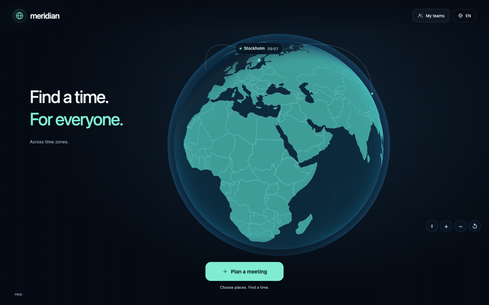
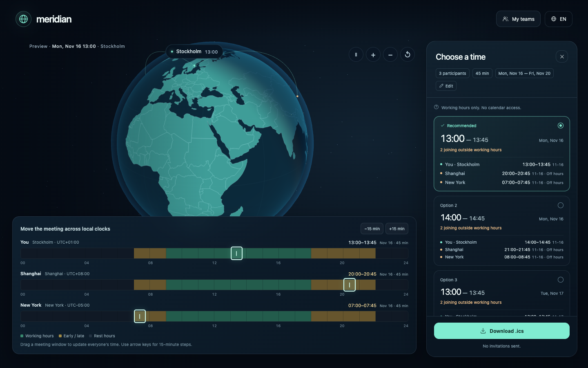

# Meridian

**A good meeting time should work for everyone.**

Meridian makes time-zone trade-offs visible before you book a meeting. Choose your location and the people you want to meet, compare local working hours, and download the time that works best.

Live demo: https://aimiaosu-blip.github.io/meridian/  
GitHub: https://github.com/aimiaosu-blip/meridian



## Try it

1. Press **Plan a meeting**.
2. Select your city and the other meeting locations. Use the quick city buttons, saved teams, or **More cities → country/region → city**. Search is optional.
3. Choose a date and duration, then **Find times**.
4. Compare the suggestions or drag the time window to adjust it for everyone.
5. Download the `.ics` file and add it to your calendar.

No sign-in, API key, or text prompt is needed.

## What it does

- A slowly rotating geographic globe, with WebGL and Canvas2D rendering.
- About **34,000 cities and urban districts** across **244 countries and territories**.
- **30 interface languages**, starting in English.
- Meetings with **2–20 participants or locations**, including independently saved teams in the same city.
- Synchronized, draggable local-time bars: green for working hours, amber for early/late hours, and dark for rest time.
- Daylight-saving and fractional-offset time-zone handling.
- Calendar file download, plus optional Google Calendar handoff and file sharing where supported.



## Run locally

```sh
python3 -m http.server 4173 --bind 127.0.0.1 --directory dist
```

Open [localhost:4173](http://localhost:4173). There is no install or build step. Libraries, map geometry, and city data are bundled. Serve the folder over HTTP; opening `index.html` directly as a local file is unsupported.

For the automated tests, use Node.js 20 or newer:

```sh
npm test
```

The tests cover date boundaries, daylight-saving transitions, whole-meeting availability, time dragging, city identity, localization, and calendar export.

## Deploy

GitHub Pages publishes the `gh-pages` branch. The branch contains the contents of `dist/` at its root, plus `.nojekyll`. In **Settings → Pages**, the publishing source is **Deploy from a branch → gh-pages → /(root)**. No application secrets or paid services are required.

The same `dist/` directory can also be hosted by any static web host. All application asset paths are relative, so a repository subpath is supported.

## Data and privacy

Meeting calculations run in the browser. Saved teams and preferences stay in that browser's local storage; they are not synchronized between devices. The app does not call a language-model API.

The planner uses the working hours you provide. It does **not** check calendar conflicts or public holidays, send invitations, or create video links. A calendar export adds an event only. Calendar import support varies between devices and apps.

The time bars show work/rest preferences, not astronomical night. City coverage includes urban districts and is not exhaustive for smaller settlements. City names retain source spellings except for selected localized major cities; interface translations have not received native-speaker editorial review. Physical Android devices and native calendar imports have not been tested.

## Source map

| Path | Purpose |
| --- | --- |
| `dist/js/app.js` | Interface, city picker, saved teams and calendar flow |
| `dist/js/planner.js` / `planner-worker.js` | Time recommendations and background calculations |
| `dist/js/timeline.js` | Synchronized local-time comparison |
| `dist/js/globe.js` / `globe-canvas.js` | Interactive geographic globe |
| `dist/js/engine.js` / `calendar.js` | Time-zone primitives and calendar files |
| `dist/js/*i18n.js` / locale modules | Language support |
| `dist/data/` / `dist/vendor/` | Bundled geography, city records and libraries |
| `tests/` | Automated checks |

Some earlier parser and preparation modules remain covered by tests; the current interface uses explicit selections rather than free-form chat.

## Credits and licensing

*Meridian* means a line of longitude—the geographic reference behind the name.

City data comes from [GeoNames](https://www.geonames.org/) under [CC BY 4.0](https://creativecommons.org/licenses/by/4.0/). See [city data attribution](dist/data/cities-source.md) and [third-party notices](THIRD_PARTY_NOTICES.md) for sources and licenses.

No license is currently specified for the application's original source. Third-party code and data retain their own licenses. Example teams are fictional.
